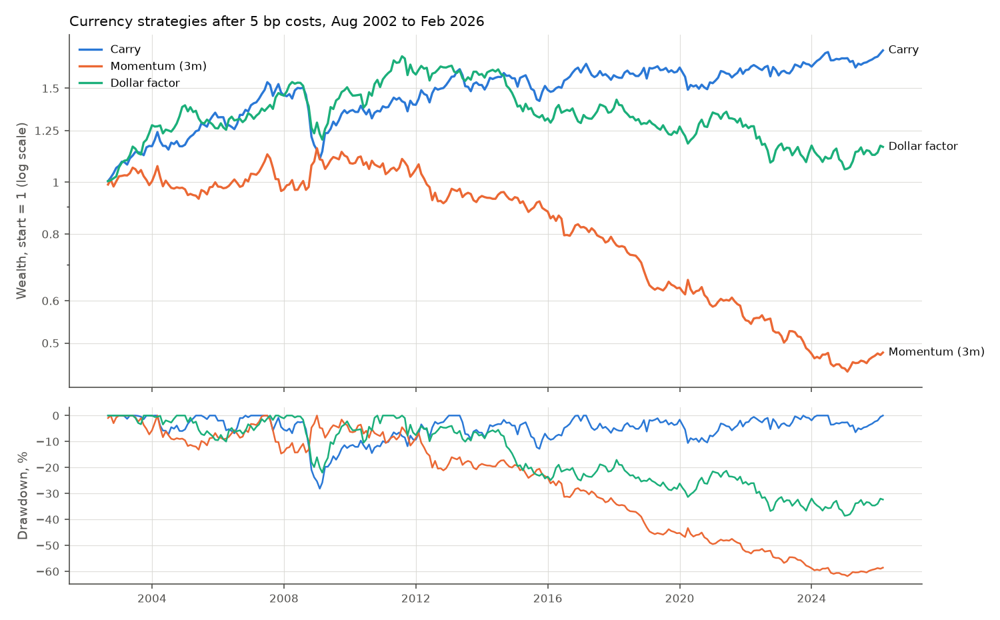
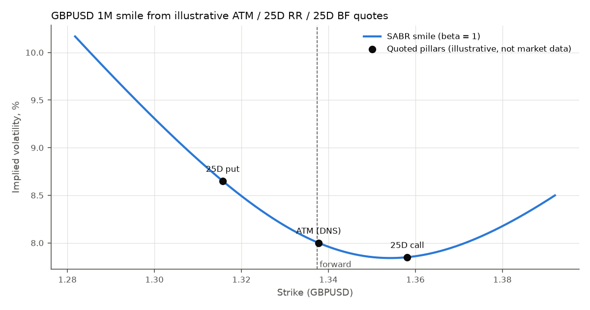
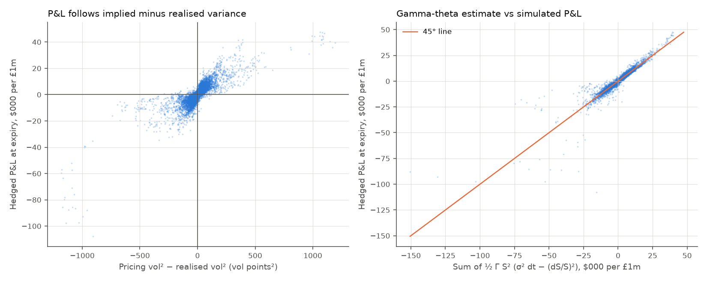

# FX Toolkit

This toolkit prices FX forwards and options, backtests currency strategies and simulates delta hedging, all on public FRED data. It has four parts:

- **Forwards.** Covered-interest-parity (CIP) forward prices, forward points and monthly forward excess returns for nine G10 currencies against the US dollar.
- **Currency strategies.** Carry, 3-month momentum and the dollar factor, rebalanced monthly. The backtest charges an explicit cost in basis points.
- **FX options.** A Garman–Kohlhagen pricer with Greeks in the four market delta conventions, and delta-to-strike conversion. A SABR smile is built from ATM, risk-reversal and butterfly quotes.
- **Delta hedging.** A short one-month GBPUSD option is hedged daily on historical spot paths, with one option sold on every trading day from 1975 to 2026.

Everything below comes from the scripts in `scripts/`, and each figure cites the output file it comes from. Nothing here was traded: all P&L is simulated.

## Data

All market data comes from FRED, downloaded by `scripts/download_data.py`. Coverage is in [`results/data_coverage.csv`](results/data_coverage.csv).

| Data | FRED series | Frequency | Coverage used |
|---|---|---|---|
| Spot rates, H.10 noon buying rates in New York | `DEXUSEU`, `DEXJPUS`, `DEXUSUK`, `DEXSZUS`, `DEXCAUS`, `DEXUSAL`, `DEXUSNZ`, `DEXNOUS`, `DEXSDUS` | Daily | To 6 Nov 2026 (EUR from 4 Jan 1999, the others from 4 Jan 1971) |
| 3-month interbank rates (OECD), monthly averages | `IR3TIB01{US,EZ,JP,GB,CH,CA,AU,NZ,NO,SE}M156N` | Monthly | Ragged: see below |
| NASDAQ Composite | `NASDAQCOM` | Daily, used at month-ends | To 9 Nov 2026 |

Every spot rate is converted to US dollars per unit of foreign currency, so a rise always means the foreign currency has strengthened. `Currency` records which way FRED quotes each pair and which way the market quotes it, e.g. USDJPY is yen per dollar.

**The interest-rate series have ragged starts and ends:**

- The JPY series starts in April 2002 and the CHF series in July 1999.
- The GBP and euro-area series end in January 2026.
- The JPY and AUD series end in August 2026; the others, USD included, end in September 2026.
- The USD series has no value for April 2020. March's value is carried into that one month, and the fill is logged in [`results/rate_gaps_filled.csv`](results/rate_gaps_filled.csv).
- No series is extended past its last observation.

The strategies use a balanced panel, i.e. only months in which all nine currencies have both a spot rate and an interest rate:

- Forwards are agreed at month-ends from April 2002 to January 2026.
- Their returns are earned from May 2002 to February 2026.
- Spot data runs to November 2026, but the panel stops in February 2026 because the GBP and euro-area rates end in January.

## Forwards

The one-month forward agreed at each month-end comes from covered interest parity with simple money-market rates:

F = S × (1 + r_USD × d / 360) / (1 + r_foreign × d / B)

Here d is the number of calendar days to the next month-end and B is the foreign day-count basis: 365 for GBP, CAD, AUD and NZD, 360 otherwise.

The excess return of a long forward on the foreign currency, earned over month t, is S_t / F_{t−1} − 1 per dollar of notional. It needs no cash up front, so it is a return in excess of the dollar interest rate.

Forward points at the last month-end of the balanced panel, in market quotes ([`results/forward_points.csv`](results/forward_points.csv)):

| Pair | Spot | 1M forward | Points (pips) | USD rate | Foreign rate | Carry, % p.a. |
|---|---|---|---|---|---|---|
| EURUSD | 1.1885 | 1.1900 | +14.8 | 3.63% | 2.03% | −1.62 |
| USDJPY | 154.34 | 154.04 | −30.1 | 3.63% | 1.12% | −2.54 |
| GBPUSD | 1.3729 | 1.3729 | −0.3 | 3.63% | 3.71% | +0.03 |
| USDCHF | 0.7710 | 0.7688 | −21.9 | 3.63% | −0.04% | −3.71 |
| USDCAD | 1.3557 | 1.3542 | −15.5 | 3.63% | 2.19% | −1.49 |
| AUDUSD | 0.6995 | 0.6995 | −0.5 | 3.63% | 3.77% | +0.09 |
| NZDUSD | 0.6048 | 0.6053 | +5.5 | 3.63% | 2.50% | −1.18 |
| USDNOK | 9.5902 | 9.5938 | +35.7 | 3.63% | 4.11% | +0.49 |
| USDSEK | 8.8656 | 8.8541 | −115.0 | 3.63% | 1.96% | −1.69 |

All values are for 30 January 2026, a 28-day forward. Carry is the annualised return of a long foreign-currency forward if spot does not move. A currency with lower rates than the dollar trades at a forward premium against it. That makes the points positive where the foreign currency is the base (EURUSD) and negative where the dollar is the base (USDJPY).

## Currency strategies

| Strategy | Signal at each month-end | Position for the next month |
|---|---|---|
| Carry | Forward discount S/F − 1, annualised (≈ foreign minus US rate) | Long the 3 highest, short the 3 lowest, 1/3 each |
| Momentum (3m) | Compounded forward excess return over the last 3 months | Long the 3 highest, short the 3 lowest, 1/3 each |
| Dollar factor | None | Long all 9 currencies against USD, 1/9 each (Lustig, Roussanov and Verdelhan, 2011) |

Positions are rebalanced monthly. The weights decided at the end of month t − 1 earn month t's forward excess returns, so no strategy uses information from the month it is paid for.

**Transaction costs.** Each month the backtest charges 5 bp per dollar of notional traded (the change in weights). The 5 bp is an assumption, not a measured spread; the cost table below shows 0 to 20 bp. All three strategies start in August 2002, the first month momentum has three months of returns behind it, so they cover the same 283 months to February 2026.

Results after 5 bp costs ([`results/strategy_summary.csv`](results/strategy_summary.csv)):

| Strategy | Ann. return | Ann. vol | Sharpe | t-stat | Skew | Max drawdown | Worst month | Corr. with NASDAQ | Monthly turnover |
|---|---|---|---|---|---|---|---|---|---|
| Carry | 2.7% | 7.2% | 0.37 | 1.81 | −0.62 | −28.2% | −10.6% (Oct 2008) | 0.44 | 0.10 |
| Momentum (3m) | −2.8% | 7.2% | −0.39 | −1.91 | +0.21 | −61.8% | −6.9% (Jun 2016) | −0.17 | 1.58 |
| Dollar factor | 1.0% | 8.1% | 0.12 | 0.58 | −0.12 | −38.6% | −8.9% (Oct 2008) | 0.44 | 0.00 |

- Returns are monthly forward excess returns, annualised: mean × 12, volatility × √12.
- Skew is of monthly returns.
- *Corr. with NASDAQ* is the correlation of monthly returns with the NASDAQ Composite's monthly price return.
- *Monthly turnover* is the average sum of absolute weight changes per month.



The five worst months of each strategy are in [`results/worst_months.csv`](results/worst_months.csv).

| Carry | Momentum (3m) | Dollar factor |
|---|---|---|
| Oct 2008: −10.6% | Jun 2016: −6.9% | Oct 2008: −8.9% |
| Sep 2008: −6.6% | Jun 2012: −5.4% | Sep 2011: −6.9% |
| Mar 2020: −5.4% | Oct 2022: −5.1% | May 2010: −5.5% |
| Aug 2007: −4.6% | Nov 2007: −5.0% | May 2012: −5.3% |
| Jun 2013: −4.6% | Sep 2007: −4.7% | Apr 2022: −5.2% |

Effect of the cost assumption on the Sharpe ratio ([`results/cost_sensitivity.csv`](results/cost_sensitivity.csv)):

| Cost per dollar traded | 0 bp | 2 bp | 5 bp | 10 bp | 20 bp |
|---|---|---|---|---|---|
| Carry | 0.38 | 0.38 | 0.37 | 0.36 | 0.35 |
| Momentum (3m) | −0.26 | −0.32 | −0.39 | −0.52 | −0.78 |
| Dollar factor | 0.12 | 0.12 | 0.12 | 0.12 | 0.12 |

What the backtest shows:

- **Carry earned a modest premium with a crash risk.** Its Sharpe ratio is 0.37 after costs, with a t-statistic of 1.81: not significant at 5% over 23.6 years. Its monthly returns are negatively skewed (−0.62).
- **The 2008 carry crash.** Carry lost 6.6% in September and 10.6% in October 2008, and 19.5% compounded over September to November ([`results/strategy_returns.csv`](results/strategy_returns.csv)). In both months it was long AUD, NZD and NOK and short JPY, CHF and CAD ([`results/carry_weights.csv`](results/carry_weights.csv)). Its largest drawdown, −28.2%, ran from the end of June 2007 to the end of January 2009.
- **Carry and the dollar factor both move with equities.** Each has a correlation of 0.44 with NASDAQ returns. Both lost in October 2008 (−10.6% and −8.9%) and in March 2020 (−5.4% and −3.2%) ([`results/strategy_returns.csv`](results/strategy_returns.csv)).
- **Carry's positions are persistent.** Across the 283 months it was long NZD in 95% of months and AUD in 76%, and short CHF in every month and JPY in 62% ([`results/carry_positions.csv`](results/carry_positions.csv)). Its turnover is low, so costs barely matter: the Sharpe ratio falls from 0.38 at 0 bp to 0.35 at 20 bp.
- **Short-term momentum lost money over this sample.** It lost money even before costs (Sharpe −0.26), and its turnover, 1.58 per month, makes it sensitive to costs. It did hedge the carry crash: momentum gained 9.7% in October 2008 ([`results/strategy_returns.csv`](results/strategy_returns.csv)). Its monthly correlation with carry over the whole sample is −0.11.

## FX options

`GarmanKohlhagen` prices European options on a pair FORDOM, e.g. GBPUSD, with spot in USD per GBP and the GBP interest rate acting as a dividend yield. It provides:

- price, gamma, vega and theta;
- delta in four conventions: spot or forward, each with or without premium adjustment;
- the strike for a given delta in any of those conventions;
- the delta-neutral straddle (DNS) strike.

Without premium adjustment, delta inverts in closed form. With it, the call delta is not monotonic in the strike, so the pricer solves numerically on the market's branch, the higher strike.

**The smile.** `SabrSmile` turns three quotes into three (strike, vol) pillars and fits SABR (Hagan et al., 2002, β = 1) exactly through them. The conventions are:

- ATM is the delta-neutral straddle.
- Deltas are spot deltas without premium adjustment. This is the GBPUSD convention up to one year, because the premium is paid in USD, the domestic currency (Reiswich and Wystup, 2012).
- The butterfly is the simplified smile strangle: σ(25Δ call) = ATM + BF + RR/2 and σ(25Δ put) = ATM + BF − RR/2. Brokers quote a "market strangle", which needs a further calibration step that is not implemented here.

**The vol quotes are illustrative, set by hand, and are not market data.** FX option quotes are not freely available. Spot and rates do come from FRED ([`results/option_inputs.csv`](results/option_inputs.csv)):

| Input | Value | Source |
|---|---|---|
| GBPUSD spot | 1.3371 | FRED `DEXUSUK`, 6 Nov 2026 |
| USD rate | 3.99% (cont. comp.) | FRED, September 2026 average |
| GBP rate | 3.70% (cont. comp.) | FRED, January 2026 average, the latest available |
| Expiry | 30 days | — |
| ATM / 25Δ RR / 25Δ BF | 8.00% / −0.80% / 0.25% | Illustrative, not market data |

The SABR fit reproduces the three pillars to eight decimal places, with α = 0.0778, ρ = −0.233 and ν = 2.18 ([`results/smile_pillars.csv`](results/smile_pillars.csv)).



The pricing grid, per £1m notional, is in [`results/option_grid.csv`](results/option_grid.csv):

| Option | Strike | Vol | Premium (USD pips) | Premium (USD) | Spot delta | Spot delta, premium-adj. | Gamma (GBP per 1% spot) | Vega (USD per vol pt) | Theta (USD per day) |
|---|---|---|---|---|---|---|---|---|---|
| 10Δ put | 1.2911 | 9.72% | 17.9 | 1,786 | −0.100 | −0.101 | 62,925 | 672 | −108 |
| 25Δ put | 1.3157 | 8.65% | 50.1 | 5,013 | −0.250 | −0.254 | 127,959 | 1,216 | −172 |
| ATM (DNS) call | 1.3378 | 8.00% | 120.2 | 12,024 | 0.498 | 0.489 | 173,414 | 1,525 | −207 |
| 25Δ call | 1.3581 | 7.85% | 44.4 | 4,442 | 0.250 | 0.247 | 140,999 | 1,216 | −161 |
| 10Δ call | 1.3783 | 8.14% | 14.6 | 1,463 | 0.100 | 0.099 | 75,166 | 672 | −92 |

The convention matters. At the 8% ATM vol, the 25-delta call strike differs by up to 4.1 pips across the four conventions and the 25-delta put strike by up to 4.0 pips. The ATM DNS strike with premium adjustment is 7.0 pips below the one without ([`results/delta_conventions.csv`](results/delta_conventions.csv)).

## Delta hedging

**The experiment.** On every trading day from 2 January 1975, a dealer sells a one-month call on GBP struck at the forward:

- The option is priced with Garman–Kohlhagen and hedged by holding its spot delta in sterling, rebalanced at each daily fixing.
- The cash account earns the USD rate and the sterling held earns the GBP rate. Each day uses the previous month's OECD average, so nothing is known before it happens.
- At expiry the dealer pays the payoff and closes the hedge.

**The pricing vol.** It is the trailing realised volatility over the previous 21 daily returns. This is a stand-in, because historical GBPUSD implied volatility is not freely available. Volatility and time are both measured in calendar days (ACT/365), so a weekend return is matched by three days of time decay.

**The sample.** There are 12,812 options. The last expires on 27 February 2026: January 2026 is the last GBP rate on FRED, and it is used through February.

For each step, theory says the hedged short option earns ½ Γ S² (σ²·dt − (dS/S)²): theta collected minus the gamma loss on the day's move. Summed over the life, the P&L should therefore track implied minus realised variance.

Results per £1m notional, in USD at expiry ([`results/delta_hedge_summary.csv`](results/delta_hedge_summary.csv)):

| Sample | Options | Mean premium | Mean P&L | Median | Std. dev. | 5th pct | 95th pct | Worst | Share > 0 | Skew |
|---|---|---|---|---|---|---|---|---|---|---|
| Every trading day | 12,812 | 16,357 | +209 | +74 | 6,873 | −8,816 | +9,591 | −107,743 | 50.7% | −1.85 |
| First trading day of each month (no overlap) | 613 | 16,330 | +152 | +65 | 6,926 | −8,665 | +9,148 | −87,723 | 50.7% | −2.77 |

| Sample | Mean pricing vol | Mean realised vol | Corr(P&L, σ²_pricing − σ²_realised) | P&L on gamma-theta estimate: slope, R² |
|---|---|---|---|---|
| Every trading day | 8.81% | 8.79% | 0.83 | 0.95, 0.88 |
| First trading day of each month | 8.81% | 8.83% | 0.85 | 1.05, 0.85 |



What the simulation shows:

- **The P&L tracks implied minus realised variance.** The correlation with the variance gap is 0.83. The sum of daily gamma-theta terms explains 88% of the variance of the P&L across options, with a slope of 0.95.
- **The mean is close to zero, but the tail is not symmetric.** Trailing realised vol is close to an unbiased forecast on average (8.81% against 8.79% realised), so the mean P&L is small: +$209 on a mean premium of $16,357. But the distribution is negatively skewed (−1.85). A seller pricing at trailing vol collects small gains in calm months and takes large losses when volatility jumps.
- **The worst options span known stress events.** The ten worst episodes are in [`results/delta_hedge_worst.csv`](results/delta_hedge_worst.csv). They include:
  - the option sold on 24 May 2016, which expired on 24 June 2016, the day after the EU referendum: −$107,743;
  - the option sold on 21 August 1992, whose life included sterling's exit from the ERM: −$27,260;
  - the option sold on 8 September 2008: −$26,042.
- **The gamma-theta estimate fails for large one-day moves.** For the 24 May 2016 option it gives −$15,646 against the simulated −$107,743 ([`results/delta_hedge_paths.csv`](results/delta_hedge_paths.csv)). GBPUSD fell 7.8% at the last fixing, from 1.4800 to 1.3639. The option was then in the money with one day left, so its delta was close to one and its gamma small. A quadratic approximation cannot capture a move that crosses the strike. The estimate errs the other way for options sold in October 1977, which were priced at very low trailing vols. For the option sold on 26 October 1977, priced at 2.6% against 12.8% realised, the estimate is −$55,542 and the simulated P&L −$28,321.
- **By decade** ([`results/delta_hedge_by_decade.csv`](results/delta_hedge_by_decade.csv)), the mean pricing vol and the mean realised vol differ by less than 0.05 vol points, and the mean P&L ranges from −$419 (2010s) to +$1,223 (1975–79).

## Design

```
FredClient ──> FxDataStore (CSV files in data/fred/)
                  │ daily spot (USD per unit), monthly rates (Period index)
                  ▼
Currency (FRED series, quote direction, day count, pip)
                  │
                  ▼
MonthlyFxPanel: month-end spot, CIP forwards, carry, excess returns, balanced()
                  │
Strategy (abstract) ─┬─ SortedLongShort (abstract) ─┬─ Carry
                     │                              └─ Momentum
                     └─ DollarFactor
                  │ weights
                  ▼
StrategyBacktest: holds weights for a month, charges cost_bp on turnover ──> BacktestResult (stats, drawdowns, worst months)

GarmanKohlhagen (one pair, one expiry): price, delta (4 conventions), gamma, vega, theta, strike_from_delta, atm_dns_strike
SmileQuotes (ATM, RR25, BF25) ──> SabrSmile.calibrate(): vol(K), strike_at_delta()
DeltaHedgeSimulator (spot and rate history) ──> HedgeOutcome per start date
```

Each class has one job and a small public interface; the docstrings explain why it exists.

- **`Currency`** is an immutable record. It keeps a currency's data series, quote direction and day count together.
- **`MonthlyFxPanel`** builds the aligned monthly tables once. Every strategy then uses the same timing convention.
- **A `Strategy` only returns weights.** A new signal needs just a `signal()` method on a `SortedLongShort` subclass; the backtest is unchanged.
- **`GarmanKohlhagen`** stores the market inputs once, and its methods take strike and vol. Its formulas accept NumPy arrays, so the hedging simulation prices a whole path in one call.

## How to run

```bash
python -m venv .venv && source .venv/bin/activate
pip install -e ".[dev]"
pytest                                # 93 tests on synthetic data, no network needed
python scripts/download_data.py       # FRED → data/fred/*.csv and results/data_coverage.csv
python scripts/run_strategies.py      # forwards, carry, momentum, dollar factor → results/
python scripts/run_options.py         # pricer and smile on illustrative vol quotes → results/
python scripts/run_delta_hedge.py     # daily delta-hedging of one-month GBPUSD calls → results/
```

`run_strategies.py --cost-bp 10` reruns the backtest with a different cost.

**What the tests check:**

- put–call parity;
- every Greek against finite differences;
- the CIP forward and the absence of arbitrage;
- the delta↔strike round trip in all four conventions;
- that the smile reproduces its input quotes;
- the sorting and weighting logic, and that momentum cannot see the future;
- the backtest arithmetic on a hand-calculated toy series;
- the hedge P&L on a zero-volatility path, which is exactly the premium plus interest;
- the hedge P&L on simulated GBM paths, which is close to zero when the pricing vol is right.

## Limitations

- **Interest rates are monthly averages of 3-month interbank rates.** They are not the one-month deposit rates on the day the forward is agreed, so the forwards are approximations of market forwards.
- **The forwards assume CIP holds.** Since 2008 the cross-currency basis has made actual forward points differ from CIP; that is not modelled.
- **Spot lag, value dates and holidays are ignored.** Forwards run from one month-end fixing to the next.
- **The strategy sample is short.** It covers 23.6 years, limited by the start of the JPY rate series on FRED in April 2002. Other short-rate series on FRED reach further back for JPY and CHF, but splicing them in would mix rate types, so they are not used.
- **The panel ends in February 2026**, eight months before the spot data ends, because the GBP and euro-area rates end in January 2026.
- **Transaction costs are a single assumed number.** It does not vary by currency or over time. Rolling an unchanged position into a new forward is not charged.
- **There are no implied volatilities.** The smile uses illustrative quotes. The delta-hedging experiment prices at trailing realised vol, so it measures how well past volatility forecasts future volatility, not the volatility risk premium that a seller at market implied vol would earn.
- **The hedge is idealised.** Hedging is daily at the New York noon fixing, with no bid–offer on the hedge trades, constant rates over each option's life, and a single strike (at the money forward).
- **FRED H.10 rates are noon buying rates**, not tradable prices.

## Roadmap

- Market-strangle butterfly calibration, and premium-adjusted conventions for USD-premium pairs such as USDJPY
- Vanna–volga pricing as a cross-check on SABR
- Cross-currency basis in the forward prices, from published basis data if a free source exists

## References

- Garman, M. and Kohlhagen, S. (1983). Foreign currency option values. *Journal of International Money and Finance*.
- Hagan, P., Kumar, D., Lesniewski, A. and Woodward, D. (2002). Managing smile risk. *Wilmott Magazine*.
- Lustig, H., Roussanov, N. and Verdelhan, A. (2011). Common risk factors in currency markets. *Review of Financial Studies*.
- Menkhoff, L., Sarno, L., Schmeling, M. and Schrimpf, A. (2012). Carry trades and global foreign exchange volatility. *Journal of Finance*.
- Reiswich, D. and Wystup, U. (2012). FX volatility smile construction. *Wilmott*.
